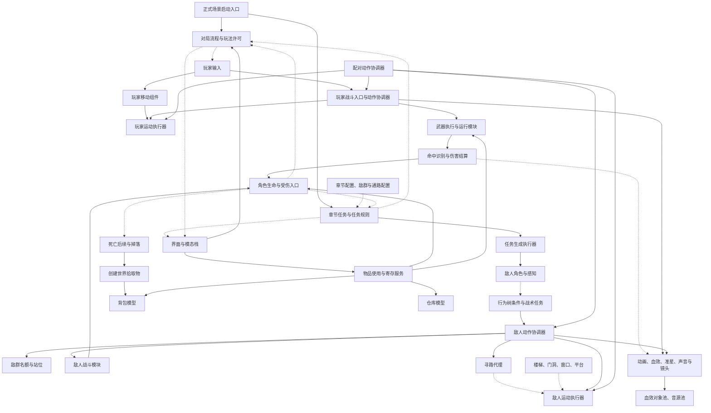

# 阶段一至六重构全览与模块调用链

这份说明面向维护正式村庄主场景的人。遇到一个新需求，可以先在调用链表找到负责决定的入口，再找到保存状态的对象，最后选择执行或表现组件。六个阶段按当时实际迁移的内容整理。源码链接指向阶段七拆分程序集后的工作区。

## 一、六个阶段分别解决了什么

### 阶段一　让一次请求可以被批准、拒绝、追踪和撤销

**原架构与调整原因**　角色、行为任务和动画之间常用布尔量或无编号回调交接。收到“动作结束”时，调用者难以区分这次通知属于当前攻击，还是对象回收前的上一次攻击。场景和预制件里的组件引用又必须与代码同步变更，仅凭脚本编译无法发现漏绑。

**调整方式**　引入对象身份与租用版本、请求上下文、动作句柄、明确的请求结果、运动和通行凭证、玩法许可句柄、伤害请求与结果、只读角色快照。每个动作通道管理自己的有效期。固定容量诊断记录保存请求和状态变化；编辑器工具按登记的资源预览、应用、校验和回退。阶段零预先保存用户工作区、正式资源绑定、实际参数和已知缺陷。

**目的与收益**　发起者可以区分冷却、动作冲突、名额不足和过期回调。释放动作和回收角色后，旧凭证不能再提交结果。迁移工具还能核对资源版本，避免重复挂组件或覆盖之后的修改。这些能力在后续阶段分别接入敌人、通路和玩家动作。[公共契约](../../Assets/Scripts/架构/公共契约.cs) · [基线与迁移记录](实施记录与剩余工作.md)

### 阶段二　从敌人主控制器迁出生命、感知、战斗、动作和表现

**原架构与调整原因**　同一控制器同时采样视线、改变警觉、推进攻击、累计硬直、切换爬行、写动画和处理死亡。行为任务还能停止寻路或写动画参数。攻击被中断后，旧动画退出回调可能干扰新动作。对外暴露一个“敌人状态”，也难以区分失去目标、动作受阻和角色已死亡。

**调整方式**　生命组件保存当前血量和死亡事实；感知模块保存视线、声音、警觉和最后已知位置；战斗模块推进攻击窗口、冷却、命中记录、硬直、体术机会及爬行起身；动作协调器审批战术请求并持有动作编号；动画适配器统一业务动画参数和图层写入。行为树条件读取快照，动作节点提交意图。正式预制件、场景独立角色和电锯桥接绑定到同一角色上的对应组件，保留原行为树与动画图。

**目的与收益**　修改目标记忆、修改受击中断和修改命中窗口各有入口。四个新模块迁出的七十四个私有字段没有在旧控制器保留第二份可写存储。普通敌人与电锯敌人的重复死亡只通知一次。原有挥空补判、战斗中跳过硬直衰减仍登记为独立玩法问题。[职责及冲突表](阶段二职责与调用契约.md) · [验收范围](阶段二验收记录.md)

### 阶段三　分开路径计算、通行资格、群体名额和实际位移

**原架构与调整原因**　追击路径、攻击根运动、贴地和避让都可能影响最终位置。角色类持有静态楼梯队列，使独立楼梯的占用难以区分。长会话里，平台上的敌人能通过连续的小幅贴地修正逐渐向下偏离；退出运行时，迟到的配对释放还可能重建已销毁的行为树管理器。

**调整方式**　寻路代理拥有路径和请求版本；每条楼梯、门洞、窗口或跳落路线持有各自的排队与通行凭证；每个角色的运动执行器控制最终位置和朝向。敌群只分配攻击名额和包围站位。保留原避障、碰撞和分段算法。随后单独修正平台下楼资格，并在停用清理时检查角色、场景和原管理器的生命周期。

**目的与收益**　路径可达、已取得通行资格、有权写入最终位移可以分别验证。两条路线独立排队，旧凭证无法释放新占用。相同六十次推进中，修复后的平台高度保持三点二米；三组对应性能样本均在预算内。[运动与通路归属](阶段三验收记录.md) · [故障复现](阶段三故障修复与补充验收.md) · [性能对照](阶段三性能与剩余验收记录.md)

### 阶段四　让玩家动作、弹药、伤害和配对各自提交一次结果

**原架构与调整原因**　移动、换弹、受击和翻越共享一个玩家状态表达，但它们有不同中断规则。动画退出、装填协程和武器数据之间容易错配。命中识别兼管伤害及表现，配对协调器也曾直接操作双方位姿。小刀耗尽耐久时立即切枪会被当前动作拒绝，随后丢失请求。

**调整方式**　移动阶段归移动组件，武器动作及全身动作归动画动作协调器。武器运行模块持有装备、弹匣、开火冷却和装填事务；正式备弹由背包持有。每个装填提交核对事务编号。命中识别向结算入口报告目标与部位，生命组件确认扣血和死亡，受击表现订阅已结算事实。配对协调器保存会话和提交记录，通过双方参与者交接运动、输入和镜头。小刀损坏单独修成等待合法时机再收刀。

**目的与收益**　翻越中受到伤害时可以先结算生命，再按原规则延迟受击动作；换弹取消后，旧回调不能继续扣库存。霰弹每颗弹丸保留独立判定。四类武器仍沿用原射速、散布和装填时序。补回受击表现后重新采样，最终六轮的数字满足预算，设备状态仍影响归因。[动作与伤害契约](阶段四迁移与验收记录.md) · [小刀及受击表现复验](阶段四性能定位与独立修复记录.md)

### 阶段五　把物品、任务、界面许可和胜败结果交给各自的拥有者

**原架构与调整原因**　寄存已装备物品跨越背包、仓库和切枪，失败时有部分提交的风险。多个界面都可能影响输入和时间，关闭上层面板可能提前恢复仍被下层占用的游戏。波次、生成、计时和界面逻辑混在一起，规则离开场景就很难测试。

**调整方式**　背包和仓库模型分别拥有物品；跨容器转移先检查两端，再一起提交。物品使用服务核对请求和局版本，协调治疗、弹药和寄存。任务规则拥有波次、击杀、存活数和时间，生成执行器负责选点实例化。界面拥有模态栈与光标，用独立凭证申请许可。对局流程只接受第一个合法终局。设置拆成视图、数据和应用，掉落权重计算读取资源快照。

**目的与收益**　仓库装不下时物品仍在背包，关闭设置后下层背包仍可持有暂停。新增界面申请自己的许可，不必改任务计时代码。三波生成与通关、嵌套暂停、寄存取回均有回归。三号房另补了实际通行校验；阶段五性能第一组超限，逐轮预算仍未通过。早期二十一项场景业务的独立汇总保留，原逐项文件有历史追溯缺口。[状态归属](阶段五状态归属与验收记录.md) · [补充验收](阶段五性能与补充验收记录.md) · [明细追溯](检查结果/阶段五/场景业务明细追溯说明.md)

### 阶段六　让一局从同一个入口启动，并把运行有效值固化到配置

**原架构与调整原因**　主界面可以补建对局对象，组件会在启动时搜索玩家、相机和通路，部分检视面板参数还会被启动代码改写。直接运行场景和从标题进入可能走不同路径，开发者在面板看到的值不一定是实际值。

**调整方式**　主场景显式绑定启动入口、对局、玩家、任务、敌群、通路、教学和界面。先关闭输入与模拟，校验依赖，再准备生成与通路、连接订阅、开放任务与输入。缺配时报告具体字段。章节资产保存波次，场景保存敌群有效参数、入村触发区及五段楼梯配置。动态生成对象接收本局路线等上下文。界面延后启用时读取现有任务和终局。

**目的与收益**　标题进入和直接开局共用启动顺序。主画布隐藏时首波仍可生成，缺波次资产时不会带着半套服务继续运行。十三项敌群参数、十三项波次参数和五十五个楼梯碰撞体与基线一致。六轮独立程序样本有效，第一组帧耗时及分配中位数超出门槛；视听与手感仍需人工签收。[启动与功能验收](阶段六场景启动与验收记录.md) · [性能与回退](阶段六性能与补充验收记录.md)

## 二、模块流程图

实线表示请求、批准后的执行或数据提交。虚线表示已发生的事实、只读结果或配置输入。动作审批和运动授权是两个检查点。即便角色已经进入攻击动作，它仍须通过运动执行器才能移动。

图中的生命到任务箭头，具体经敌人角色的一次性死亡通知抵达任务；玩家死亡走对局失败入口。图中的寻路和通路到运动箭头分别提供方向及通行资格，最终位移由当前持证来源提交。

## 三、逐模块调用链

从左向右阅读。表内的“调用者”包含会发出请求的上游，“下游”说明批准后谁执行或谁收到事实。同一物理帧内的碰撞、动画和镜头更新沿用原有引擎阶段。

| 模块 | 调用者 → 入口 → 下游 | 独占状态、返回或事实 |
|---|---|---|
| 公共契约、动作有效期与诊断 | 输入、行为任务或动画标记 → 角色请求入口检查身份、关联号和凭证 → 返回动作结果，按需记录诊断 | 有效期拥有当前句柄；诊断拥有有限历史，不决定玩法 |
| 场景启动入口 | 标题加载或直接运行主场景 → `场景启动入口.Start` → 校验引用与模板 → 准备任务、楼梯、敌群、教学并开放本局 | 准备、运行、配置错误、关闭；错误时保留阻断许可 |
| 对局流程 | 玩家死亡 → `GameManager.OnPlayerDeath`；任务达成 → `TryCompleteMission` → 对局流程提交 → 发布死亡或通关 | 唯一胜败结果和通关数据；先到的合法结果生效 |
| 玩法许可 | 启动、模态界面、轮盘或配对输入 → 申请、更新、释放凭证 → 对局应用时间倍率、音频和玩家输入 → 任务查询计时许可 | 占用记录、最终倍率和许可快照；关闭面板只释放自己的占用 |
| 输入与玩家战斗入口 | 输入动作 → `LeonInputBridge` → `LeonCombat` 处理瞄准、开火、换弹意图 → 动作或武器入口 | 输入映射、意图、按键缓冲和逐发协程；不保存真实弹量 |
| 玩家动作协调 | 换弹、切枪、翻越、受击、配对或死亡请求 → `LeonAnimationActionCoordinator` 与动作冲突规则 → 开始、取消或结束动画事务 | 武器动作、全身动作、事务号；旧玩家状态是只读投影 |
| 玩家移动与运动执行 | 移动输入 → `LeonLocomotion` 计算速度、转向、蹲伏 → 玩家运动执行器提交刚体位移；翻越、下落和配对经控制权交接 | 移动组件拥有速度、阶段和平滑缓存；执行器拥有运动凭证与实际提交 |
| 武器持有者及运行模块 | 选武器或寄存 → `LeonWeaponHandler` 审批切换 → 装备提交；开火 → `WeaponBase.FireAt` → 运行模块检查弹匣、冷却并扣弹 → 枪械发射 | 装备、弹匣、冷却和装填事务；正式备弹在背包，没有背包时使用旧兼容备弹 |
| 装填提交 | 换弹输入 → 战斗入口与动画协调器 → 开始带编号装填 → 动画标记或逐发协程 → 武器运行模块核对编号 → 扣背包备弹、补弹匣 | 取消使旧编号失效；整匣仅提交一次，逐发按原时序逐次提交 |
| 命中识别与伤害结算 | 枪械射线或小刀判定 → 识别目标与部位 → 伤害入口 → 目标受伤 → 表现订阅已提交命中 | 带编号的请求返回实际扣血和本次是否致死。敌人命中广播携带部位倍率结算值，武器局部通知携带基础伤害。霰弹各弹丸独立 |
| 玩家与敌人生命 | 受伤或治疗请求 → 玩家 `HealthComponent` 或敌人角色生命模块 → 确认血量和死亡 → 玩家动作终止或敌人一次性死亡后续 | 各自唯一的血量和死亡事实；表现、任务与掉落不改血量 |
| 敌人感知 | 原更新阶段、声音或群体警报 → 感知模块采样视线、更新警觉与记忆 → 行为树读取快照 | 可见结果、最后已知位置、警觉和调查进度；查询不会推进记忆 |
| 行为树与敌人动作协调 | 条件节点读快照 → 任务选择追击、巡逻、攻击等意图 → `请求动作／提交` → 校验死亡、姿态、冷却和名额 → 战斗或移动执行 | 行为任务保存局部进度；协调器拥有当前动作、编号与中断恢复。拒绝有原因 |
| 敌人战斗 | 获准攻击或受击 → 战斗模块推进命中窗口、硬直与体术机会 → 提交伤害或请求姿态变化 → 动作协调器交接 | 攻击进度、命中记录、冷却、爬行与起身；收到过期动画标记时不推进新动作 |
| 敌群协调 | 角色登记、感知警报或动作审批 → `EnemyAIManager` 分配攻击名额、追击目标与站位 → 角色收到资源结果或战术命令 | 本局成员名册、名额、包围位及群体冷却；成员退出时释放 |
| 寻路代理 | 获准追击或巡逻 → 角色移动上下文向 `PathAgent` 提交目标 → 寻路插件计算 → 核对请求版本 → 返回路径方向或到达结果 | 当前路径、请求版本与重算缓存；路径回调不能覆盖新请求 |
| 场景通路 | 角色抵达入口 → 对应楼梯、门洞、窗口、跳落路线申请 → 本通路排队及容量审批 → 持证分段推进 → 出口交接或取消 | 每条物理通路各自拥有队列、方向和占用。重复释放无效 |
| 敌人运动执行 | 普通路径、攻击根运动、专用通行或配对 → 动作协调器授权 → `角色运动执行器.提交位姿` 等入口 → 碰撞约束与位置提交 | 当前运动控制权、交接编号、实际位移；下楼须通过路线资格检查 |
| 玩家楼梯辅助 | 启动入口 → `LeonPlayerStairRampRuntime` 按场景分段准备坡面、护栏和踏步 → 移动与碰撞使用；角色启停更新碰撞登记 | 场景桥面引用和本局碰撞体缓存；敌人的通行队列仍归对应路线 |
| 配对、体术和处决 | 玩家交互或敌方机会 → `LeonQTECoordinator` 申请双方动作、运动、输入和镜头 → `IEnemyQTEParticipant` 与玩家参与逻辑推进 → 结果提交一次 → 释放 | 会话编号、双方、阶段与提交记录；生命或武器变化交其业务入口处理 |
| 背包与仓库 | 拾取、拖拽、排序、合成或寄存 → 背包／仓库场景外壳 → 对应模型规划放置及堆叠 → 原子转移 → 双方变化通知 | 物品实例、数量、位置、旋转和耐久；界面读快照或只读集合 |
| 物品使用与装备寄存 | `UseItemAt` → 使用服务核对编号、局版本和目标 → 生命或武器接口 → 成功后消耗。寄存已装备武器 → 请求切换 → 回调再核对原物品与会话 → 提交转移 | 本次使用或寄存请求及重入保护；没有第二份库存 |
| 章节配置与任务规则 | 启动入口 → 章节任务读取波次资产 → 初始化规则 → 生成成功、角色死亡及获准时间分别登记 → 推进波次或向对局提交通关 | 配置资产保存目标与间隔；规则保存波次、计时、存活登记和击杀 |
| 任务生成执行 | 任务要求生成 → 生成执行器按原净空、距离和寻路条件选点 → 生成预制件并绑定本局通路 → 任务登记角色、订阅死亡 → 规则更新 | 选点、轮询与无效点缓存；生成失败不登记成功数量 |
| 掉落与拾取 | 敌人死亡 → 掉落管理按快照计算权重，或木箱破坏选定奖励 → `DropManager.SpawnItemPickup` 创建世界对象并挂拾取组件 → 玩家拾取后进入背包 | 掉落管理保存连续掉落历史。当前拾取物逐次创建；原计划中的拾取物池化仍待实现。[掉落实例化入口](../../Assets/Scripts/Drop/DropManager.cs) |
| 界面、背包附加场景、进度 | 菜单输入 → `GameUIManager` 模态栈申请许可；背包加载器开关附加场景与相机；任务进度订阅快照；迟启界面读取既有死亡或胜利 | 面板、选中、光标、订阅和表现缓存；附加场景沿用本局模型 |
| 设置与教学 | 设置页 → 设置数据读取或写入原偏好键 → 设置应用适配器应用；教学触发器、玩家已移动或当前武器低弹量 → 教学管理 → 更新提示 | 设置保存用户值，教学保存原完成标记；两者均不能自行启动任务 |
| 动画、镜头、声音、特效、准星 | 动作请求 → 对应动画适配器／驱动器 → 动画标记带事务身份回报；配对会话 → 镜头表现；已结算命中 → `EnemyHitEffectManager` 和其他订阅者 → 血效、声音、准星 | 插值、图层、显示和播放缓存。表现回调只能报告标记，不能自行二次扣血或发任务奖励 |

### 怎样追踪同一发子弹

以枪械命中一个原剩五点生命、头部倍率为二的普通敌人为例。若武器基础伤害为十，枪械局部通知携带十，敌人命中广播携带二十。带编号的伤害请求比较受伤前后的生命，返回实际扣除的五点及本次致死标记。血效和准星订阅敌人命中广播。任务订阅角色的死亡通知；挂有行为树的实例在行为树进入死亡动作后通知任务，因此命中帧内任务击杀数可能尚未增加。对应源码见[武器命中入口](../../Assets/Scripts/Combat/WeaponBase.cs)、[伤害提交](../../Assets/Scripts/Combat/伤害结算模块.cs)与[章节任务](../../Assets/Scripts/Managers/ChapterOneMissionManager.cs)。

表现和界面的各分支可以按下面的入口单独追踪。

- **血效与音源池**　命中事实 → 受击表现管理器 → 血效池取出实例、延时归还；命中音效 → 音频管理器 → 空间音源池播放和释放。[血效订阅](../../Assets/Scripts/Combat/EnemyHitEffectManager.cs) · [音频管理](../../Assets/Scripts/Managers/AudioManager.cs)
- **准星**　瞄准与装填变化、武器提供者切换、命中事实及对局生命周期 → 准星表现器更新显示。命中订阅只消费反馈。[准星表现器](../../Assets/Scripts/Crosshair/CrosshairPresenter.cs)
- **配对镜头与动画**　会话进入、成功或失败 → 镜头表现器按配对类型选择镜头预设并推进过渡；角色动作协调器各自处理动画标记与退出。[配对镜头](../../Assets/Scripts/Camera/QTECameraPresenter.cs) · [玩家动画事务](../../Assets/Scripts/Player/LeonAnimationActionCoordinator.cs)
- **背包与寄存界面**　打开背包经附加场景加载器；交互寄存箱经寄存箱控制器进入仓库界面。两条入口都使用本局物品模型，关闭时恢复相机并释放对应许可。[背包加载](../../Assets/Scripts/UI/InventorySceneLoader.cs) · [寄存箱](../../Assets/Scripts/Inventory/StorageBoxController.cs)
- **任务显示、设置和教学**　任务快照进入进度视图；设置视图通过设置数据及适配器应用偏好；教学管理订阅输入与弹量，在解绑时撤销订阅。[任务进度](../../Assets/Scripts/UI/MissionProgressHUD.cs) · [设置应用](../../Assets/Scripts/UI/设置应用适配器.cs) · [教学](../../Assets/Scripts/UI/TutorialManager.cs)

## 四、怎样沿新边界扩展

| 新需求 | 应改的位置 | 接入后首先验证 |
|---|---|---|
| 新增已有行为的敌人变体 | 复制已迁移预制件，绑定同一宿主上的生命、感知、战斗、动作、动画与运动组件，再加入任务模板 | 正式生成、请求动作、受击死亡、名额及通路释放 |
| 新增武器 | 配置与已有枪械执行接口、装备映射、库存物品、视觉与音频适配；特殊动作单独接入协调器 | 扣弹、取消换弹、切换和伤害结算。新增类别还需核对现有枚举及兼容备弹映射 |
| 新增任务配置 | 建立章节波次资产，填目标、波次数量、间隔、时限，绑定任务组件 | 真实首波数量、快照目标、通关与死亡竞争 |
| 新增关卡或通路 | 在场景启动入口显式绑定本局服务、模板、生成点和路线；独立通路配置独立容量、队列与出口 | 缺配时保持关闭；两条通路互不阻塞；取消后无残留 |
| 新增界面 | 订阅已提交事实，首次显示读取快照，通过模态凭证申请输入／暂停占用，停用时退订并释放 | 嵌套开关、附加场景卸载、隐藏期间发生终局后再显示 |

阶段七的程序集依赖、保留的兼容入口、正式资源身份和本轮回归单独登记在[阶段七编译边界与验收记录](阶段七编译边界与验收记录.md)。阶段一至六的性能和人工体验结论以各阶段实测为准。
