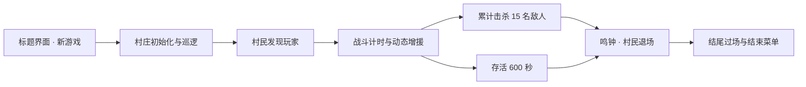

# Unity-RE4-Remake

**使用 Unity 6 开发的第三人称生存恐怖射击原型。** 项目以《生化危机 4 重制版》第一章入村战斗为设计参考，集中实现越肩操控、枪械与小刀战斗、村民围攻与通行、配对动作、资源管理，以及以鸣钟过场收束的一局玩法。

公开仓库提供玩法源码、配置、场景引用和简中对白资源。**完整运行依赖具备原始场景资源和插件的本地工程。**

## 目录

- [正式场景与玩法流程](#正式场景与玩法流程)
- [功能一览](#功能一览)
- [默认操作](#默认操作)
- [运行时架构](#运行时架构)
- [引擎与插件](#引擎与插件)
- [项目结构](#项目结构)
- [获取源码与运行](#获取源码与运行)
- [验证与构建](#验证与构建)
- [第三方资源与项目说明](#第三方资源与项目说明)

## 正式场景与玩法流程

### 构建场景

| 顺序 | 场景 | 用途 |
| --- | --- | --- |
| 0 | [TitleScreen.unity](Assets/Scenes/TitleScreen.unity) | 标题界面。选择「新游戏」进入正式村庄。 |
| 1 | [InventoryScene.unity](Assets/Scenes/InventoryScene.unity) | 公文包界面，由游戏中打开背包时加载。 |
| 2 | [StorageBoxScene.unity](Assets/Scenes/StorageBoxScene.unity) | 寄存箱界面，通过场景中的箱子进入。 |
| 3 | [VillageBattleLighting.unity](Assets/RE4ChapterOneVillage/Lighting/VillageBattleLighting.unity) | 正式玩法场景。承担入村、围攻、任务结算及鸣钟过场。 |

场景顺序以 [EditorBuildSettings.asset](ProjectSettings/EditorBuildSettings.asset) 为准。完整工程内另有旧村庄场景 `Assets/GameScene.unity`，以及用于小刀战斗、里昂 IK、正面抓取等功能的专项验证场景。

### 从进村到鸣钟



- **开场巡逻**。村庄初始化会校验玩家、敌人模板、生成点和通路。当前配置有 **8 个巡逻位置**。任务准备完成后开放正式输入，村民发现玩家后开始战斗计时。
- **动态增援**。当前按 **每 4 次累计击杀** 结算一批增援额度。生成端根据场上数量、导航与站立空间、玩家所在区域安排刷新。满足电锯敌人出现条件且场上没有存活的电锯人时，增援可包含电锯人。
- **结束条件**。普通村民和电锯人的击杀合计达到 **15**，或正式战斗时长达到 **600 秒**，满足任一条件便启动鸣钟。失败由玩家死亡流程提交。
- **鸣钟收束**。钟声响起时村民停止追击并退场。随后游戏切入 Timeline，用镜头、动画、声音和简中字幕完成结尾，并交给结束菜单。

任务状态由 `MissionRulesModel` 保存，`ChapterOneMissionManager` 负责会话与流程，`MissionSpawnExecutor` 负责执行生成。巡逻、增援和结算参数来自 [第一章波次.asset](Assets/Configs/第一章波次.asset)，鸣钟演出时间轴见 [VillageBell.playable](Assets/RE4ChapterOneVillage/BellCinematic/VillageBell.playable)。

## 功能一览

### 第三人称操控、相机与准星

- 刚体移动、蹲伏、冲刺和越肩瞄准共用玩家控制链。自由环顾时可独立观察环境，放开后回到角色跟随。转入瞄准时同步视角、身体朝向和武器状态。
- `RE4CameraController` 管理相机接入，`RE4RThirdPersonCamera` 实现越肩偏移、镜头跟随、回正与碰撞处理。手枪、霰弹枪、步枪和小刀可以使用各自的镜头配置。
- `AimResolver` 为枪械提供统一的瞄准解算，结合相机视线和射击约束处理近距离遮挡。准星由数据、状态、生命周期和渲染接口共同驱动，可依据武器与瞄准状态切换表现。
- 配对动作可临时接管镜头，使用独立构图与轨迹。动作完成或中断时，将镜头控制权交还玩家。

主要入口见 [Camera](Assets/Scripts/Camera) 和 [Crosshair](Assets/Scripts/Crosshair)。

### 枪械、命中结算与小刀

| 内容 | 实现 |
| --- | --- |
| 枪械配置 | `WeaponData` 以 ScriptableObject 配置伤害、射速、弹匣、扩散和后坐力。射击模式包含单发、点射、自动和散弹，场景绑定决定各武器实际采用的模式。 |
| 射击与装填 | 正式枪械覆盖手枪、霰弹枪和步枪。弹匣与冷却归 `WeaponRuntimeModule`，备弹来自公文包。换弹与切枪经过动作事务，动画事件在有效事务内提交弹药变化。 |
| 射线与散弹 | `WeaponBase` 处理枪械射线与散弹弹丸。骨骼命中盒提供部位，`DamageResolutionModule` 结算实际伤害并提交命中结果。 |
| 受击表现 | 根据部位、伤害和敌人动作状态打开不同的受击、硬直和体术机会。表现模块读取已提交的结果，播放命中反馈和音效。 |
| 小刀 | 由 `KnifeCombatModule`、`KnifeCombatConfiguration` 与 `KnifeCombatRules` 共同处理攻击、防守与弹反、耐久消耗及动作条件。耐久耗尽后检查可用的备用小刀。 |
| 动画与 IK | `LeonAnimationActionCoordinator` 协调武器与全身动作，`LeonAnimatorDriver` 负责 Animator 表现。不同武器采用各自的握持姿态、手部 IK 和手指配置。 |

动作事务用于处理受击、翻越、切枪、死亡等状态冲突。动作中断时释放当前占用，过期动画回调会被事务编号校验拦截。

主要入口见 [Combat](Assets/Scripts/Combat)、[Player](Assets/Scripts/Player) 和 [战斗规则](Assets/Scripts/架构/战斗规则)。

### 敌人 AI、围攻和场景通行

- **行为树与状态**。Behavior Designer 负责编排巡逻、追击、攻击及通行意图。敌人的生命、感知、战斗和动画分别由模块维护，`VillagerController` 提供共同的角色入口。
- **围攻协调**。`EnemyAIManager` 登记敌群并管理接战、攻击名额与站位。敌人动作协调器在行为树意图和动画执行之间检查距离、时机、状态冲突与名额。
- **寻路与位移**。A* Pathfinding Project 提供寻路图和路径。项目的 `PathAgent` 处理分区路径与移动方向，通行和战斗动作的位移由 `CharacterMotionExecutor` 统一执行。
- **通行几何**。门洞、窗口、楼梯、梯子和平台跳落拥有各自的通行条件。路线会检查几何、楼层、可站立位置与占用，结束、失败或回收时释放通路。
- **电锯敌人**。电锯人使用单独的行为树和攻击动画，覆盖启锯、追击和攻击，并与配对动作、弹反及任务增援联动。

普通村民与电锯人的行为树资产见 [Assets/AI](Assets/AI)，敌人代码见 [Enemy](Assets/Scripts/Enemy)，门窗和其他交互见 [Interaction](Assets/Scripts/Interaction) 与 [Traversal](Assets/Scripts/Traversal)。

### 体术、QTE 与双方配对

- 覆盖体术踢击、正面抓取、后方咬颈、腿部撕咬、小刀暗杀、倒地补刀与电锯配对。
- `LeonQTECoordinator` 启动玩家和敌人的动作会话，处理双方对位、动画覆盖、输入窗口、动作结果和镜头。
- 配对结束或取消后，以同一会话释放双方的输入、移动与镜头占用。动作结果由会话和有效动画标记提交，防止重复结算。

主要入口见 [LeonQTECoordinator.cs](Assets/Scripts/Player/LeonQTECoordinator.cs)、[QTE 类型](Assets/Scripts/QTE/LeonQTETypes.cs) 和 [QTE 相机配置](Assets/Resources/QTECamera)。

### 公文包、物品、掉落与界面

- **公文包**。正式配置为 **10 × 6** 格，支持拖拽、旋转、自动整理、快捷槽和物品使用。治疗、合成和弹药消耗通过规则模型与应用服务提交。
- **仓库**。背包与寄存箱可进行物品转移。模型维护物品格位、数量和状态，界面显示当前快照并订阅变化。
- **拾取和检视**。场景拾取、首次获得物品时的 3D 检视、可交互门窗和可破坏木箱均接入现有交互流程。
- **动态掉落**。候选权重根据武器持有、弹药、生命、幸运、区域与重复类别调整。系统记录连续无掉落次数，并对连续出现的同一类别降权。
- **模态界面**。标题、暂停、设置、战斗 HUD、任务提示、武器轮盘、背包、仓库和物品检视共享界面与玩法许可机制。每个界面只释放自己持有的占用。

主要入口见 [Inventory](Assets/Scripts/Inventory)、[背包规则](Assets/Scripts/架构/背包规则)、[Drop](Assets/Scripts/Drop) 和 [UI](Assets/Scripts/UI)。

### 音频、简中对白与字幕

- `AudioEventData` 与 `AudioLibrary` 将音频按事件资产配置。武器、地表脚步、敌人语音、环境声与音乐各有播放入口，并可通过类别与主音量调节。
- **空仓对白**。最后一发实弹射出后保持安静，下次在弹匣为零时扣扳机才触发。无论背包还有多少备弹，均按弹匣状态判定。该组冷却 **10 秒**。
- **初见电锯人**。电锯人要先由本局任务生成并进入镜头，且头部或胸部的视线无遮挡。同一局只播放一次。另有和弹反、半血、击败相关的独白。
- **其他对白**。开战、枪械击杀、体术、踢落梯子、刀断且无备用刀、用完最后一件治疗品、拾取霰弹枪等均由现有玩法动作触发。
- **字幕表现**。战斗独白使用自写简中台词和普通话合成配音。鸣钟结尾沿用项目已有中文音轨，字幕根据 Timeline 时间显示和隐藏。字幕使用思源黑体简中 Regular，底部居中，白字配细黑阴影。

主要入口见 [VillageLeonDialogue.cs](Assets/Scripts/UI/VillageLeonDialogue.cs) 和 [对白与字幕配置](Assets/RE4ChapterOneVillage/Resources/VillageDialogue/Lines.json)。

### 对象池与表现复用

- `AudioSourcePool` 供常规音频事件复用音源，音频配置决定事件的空间表现、音量和播放策略。
- `GameObjectPoolManager` 与 `PrefabPool` 为已接入的特效提供借出、回收和扩容。粒子系统与刚体通过各自的重置组件清理上次播放或运动状态。
- 池化资源仍由使用方负责生命周期。例如命中特效以已提交的伤害结果为输入，选择表现后再向池申请对象。

代码入口见 [Audio](Assets/Scripts/Audio) 和 [Pool](Assets/Scripts/Pool)。

## 默认操作

| 键鼠 | 操作 |
| --- | --- |
| `W` / `A` / `S` / `D` | 移动 |
| 鼠标移动 | 控制视角 |
| 鼠标右键 | 瞄准，设置中可选按住或切换 |
| 鼠标左键 | 开火或执行当前战斗模式的攻击 |
| `R` | 换弹 |
| `E` | 近战快捷键。有合适目标时可发动体术、小刀暗杀，或近战破坏木箱 |
| `Space` | 弹反或防守输入 |
| `F` | 通用交互，包括拾取、开门和确认屏幕上的体术或暗杀提示。配对逃脱也用此键 |
| `Left Shift` | 冲刺 |
| `C` | 蹲伏 |
| `Left Alt` | 自由环顾。在公文包界面内用于整理 |
| `1`–`8` | 直接选择武器快捷槽 |
| 鼠标滚轮 | 调出武器轮盘并预选，停止滚动后确认切换 |
| `Tab` | 打开或关闭背包 |
| `Esc` | 暂停或关闭当前界面 |

默认绑定见 [LeonInputActions.inputactions](Assets/Scripts/Input/LeonInputActions.inputactions)。运行时会应用 `InputBindingPersistence` 保存的按键覆盖，交互提示按当前输入上下文显示。

## 运行时架构

| 链路 | 负责的状态与边界 |
| --- | --- |
| `SceneStartupEntry` → `GameManager` / `MatchFlow` | 校验场景配置，绑定本局服务，开放输入与任务，统一提交胜败。 |
| `GameplayPermissionService` → `GameUIManager` / `LeonInputBridge` | 按占用管理输入、计时、音频与时间缩放。模态状态解除后按当前许可恢复。 |
| `LeonInputBridge` → `LeonController` / `LeonLocomotion` / `LeonCombat` | 将输入映射到玩家动作。装备归 `LeonWeaponHandler`，玩家生命归 `HealthComponent`。 |
| `LeonAnimationActionCoordinator` → `LeonAnimatorDriver` | 管理武器与全身动作的开始、标记、完成和取消，再更新动画表现。 |
| `WeaponBase` → `EnemyHitbox` → `DamageResolutionModule` | 解算命中部位，提交伤害和受击结果，供音效和特效读取。 |
| 行为树任务 → 敌人动作协调器 → `EnemyAIManager` / `CharacterMotionExecutor` | 将战术意图转成经过校验的动作和位移，协调名额、站位与通路。 |
| `ChapterOneMissionManager` → `MissionRulesModel` / `MissionSpawnExecutor` | 保存击杀和时间等任务状态，执行增援与结尾。 |
| `InventoryManager` → `InventoryRulesModel` / `StorageRulesModel` | 维护物品、格位、寄存与转移，向界面发布快照和变更。 |

### 项目自有程序集

| 程序集 | 责任 | 项目内部依赖 |
| --- | --- | --- |
| `Game.Contracts` | 公共请求、快照、接口及事件契约 | — |
| `Game.CombatRules` | 武器运行、伤害、小刀等规则 | `Game.Contracts` |
| `Game.InventoryRules` | 网格、背包、寄存、物品使用与转移规则 | `Game.Contracts` |
| `Game.MissionRules` | 任务计时、存活名册、增援和结算规则 | `Game.Contracts` |
| `Game.RuleTests` | 编辑器内的规则与跨程序集测试 | 上述四个运行时程序集 |

战斗和任务规则关闭引擎引用。负责 Unity 对象、时间、表现和执行的宿主通过公共契约传入规则所需的数据。[架构全览](Docs/架构改造/阶段一至六重构全览与模块调用链.md) · [编译边界与验收](Docs/架构改造/阶段七编译边界与验收记录.md)

## 引擎与插件

### Unity 与官方包

Unity 编辑器版本为 **6000.0.76f1**，使用 **内置渲染管线、Linear 色彩空间**。项目保留新旧输入兼容设置，正式角色操控由 Input System 动作资产和输入桥接组件提供。

| 引擎或包 | 工程版本 | 项目用途 |
| --- | --- | --- |
| Unity 6 | `6000.0.76f1` | 场景、物理、动画、序列化及 Windows 桌面构建。 |
| Cinemachine | `3.1.6` | 越肩相机、自由环顾、武器镜头配置和配对镜头。 |
| Input System | `1.19.0` | 玩家、QTE、检视及 UI 动作映射，支持运行时改键。 |
| Animation Rigging | `1.4.1` | 角色动画绑定与约束权重。项目也接入了独立的 Final IK 求解器。 |
| Timeline | `1.7.7` | 鸣钟结尾的动画、镜头、音频与字幕时钟。 |
| Splines | `2.8.4` | 配对相机的运镜轨迹。 |
| Post Processing | `3.5.4` | 内置渲染管线下的场景后处理。 |
| Unity UI / uGUI | 锁定 `2.0.0`，清单声明 `1.0.0` | Canvas、界面控件、战斗 HUD 和简中字幕。 |
| TextMesh Pro | 锁定 `5.0.0`，清单声明 `3.0.9` | 工程保留的文字组件与资源。当前新增战斗字幕使用 uGUI Text。 |
| Unity Test Framework | 锁定 `1.6.0` | Edit Mode 的规则与架构回归测试。 |

包清单还包含 AI Navigation `1.1.7`、Entities `1.4.7`、Visual Scripting `1.9.4` 和 2D Sprite `1.0.0` 等依赖。正式村庄的敌人寻路由 A* Pathfinding Project 和项目通行层承担。 [引擎版本](ProjectSettings/ProjectVersion.txt) · [包清单](Packages/manifest.json) · [包锁文件](Packages/packages-lock.json)

### 第三方插件

| 插件 | 工程内位置与版本 | 项目内接入 | 上游 |
| --- | --- | --- | --- |
| **Behavior Designer**（Opsive） | `Assets/Behavior Designer/`，本地导入 | 正式村民与电锯人的行为树。自定义条件与动作任务见 [BehaviorDesigner](Assets/Scripts/Enemy/BehaviorDesigner)。 | [插件主页](https://opsive.com/assets/behavior-designer/) |
| **A* Pathfinding Project**（Aron Granberg） | `Packages/com.arongranberg.astar/`，内嵌 `5.4.6` | 导航图、路径请求、点位查询与导航烘焙。项目在其上接入门窗、楼层和通行占用。 | [插件主页](https://arongranberg.com/astar/) |
| **Final IK**（RootMotion） | `Assets/Plugins/RootMotion/FinalIK/`，本地导入 | `LimbIK`、武器双手握持、手指与脚部适配，也参与敌人部分动作的 IK 表现。 | [插件文档](https://www.root-motion.com/finalikdox/html/) |
| **DOTween / DOTween Pro**（Demigiant） | `Assets/Demigiant/`，本地导入 | 工程中保留的补间库与编辑器组件。 | [DOTween 官网](https://dotween.demigiant.com/) |
| **Animancer**（Kybernetik） | `Packages/com.kybernetik.animancer/`，内嵌 `8.0.0` | 工程保留的动画播放插件。正式玩家的动画动作由项目协调器与 Animator 驱动。 | [插件主页](https://kybernetik.com.au/animancer/) |
| **UniGLTF** | `Assets/UniGLTF/`，本地 `1.27` | 工程内保留的 glTF 资源导入工具。 | — |

### 编辑器工作流

| 工具 | 用途 |
| --- | --- |
| Unity CLI + `com.unity.pipeline` `0.9.1-exp.1` | 当前通过 Unity CLI 连接编辑器，查询状态、执行编辑器命令、编译和验证。 |
| `com.coplaydev.unity-mcp` | 清单中保留的 Git 来源编辑器集成，锁定提交为 `8618f83f`。 [上游仓库](https://github.com/CoplayDev/unity-mcp) |
| Tuanjie Codely Bridge `1.0.87`、TJ Generators | 保留的历史编辑器工具依赖。TJ Generators 由本地 `file:` 路径引用。 |

## 项目结构

| 路径 | 内容 |
| --- | --- |
| [Assets/Scripts/Core](Assets/Scripts/Core) | 地图启动、会话、胜败和玩法许可。 |
| [Assets/Scripts/Player](Assets/Scripts/Player)、[Input](Assets/Scripts/Input)、[Camera](Assets/Scripts/Camera) | 玩家移动、输入、持枪、动作事务、IK、配对与镜头。 |
| [Assets/Scripts/Combat](Assets/Scripts/Combat)、[Crosshair](Assets/Scripts/Crosshair) | 武器、射线、命中结算、命中特效和准星。 |
| [Assets/Scripts/Enemy](Assets/Scripts/Enemy)、[Assets/AI](Assets/AI)、[Assets/Navigation](Assets/Navigation) | 敌人模块、行为树、导航和通行。 |
| [Assets/Scripts/Inventory](Assets/Scripts/Inventory)、[UI](Assets/Scripts/UI)、[Drop](Assets/Scripts/Drop) | 公文包、寄存箱、物品检视、界面与掉落。 |
| [Assets/Scripts/QTE](Assets/Scripts/QTE)、[Interaction](Assets/Scripts/Interaction)、[Traversal](Assets/Scripts/Traversal) | 双方配对、门窗交互和越障。 |
| [Assets/Scripts/Managers](Assets/Scripts/Managers)、[Audio](Assets/Scripts/Audio)、[Pool](Assets/Scripts/Pool) | 任务、生成、鸣钟、音频与对象复用。 |
| [Assets/Scripts/架构](Assets/Scripts/架构)、[Assets/Editor](Assets/Editor) | 公共契约、玩法规则、编辑器工具、测试与打包。 |
| [Assets/Configs](Assets/Configs)、[Assets/Settings](Assets/Settings)、[Assets/Resources](Assets/Resources) | 武器、波次、相机、音频、物品与动态加载配置。 |
| [Assets/Prefab](Assets/Prefab)、[Assets/Scenes](Assets/Scenes)、[Assets/RE4ChapterOneVillage](Assets/RE4ChapterOneVillage) | 角色和功能预制件、正式场景与村庄结尾配置。 |
| [Docs/架构改造](Docs/架构改造) | 玩法架构、程序集边界、回归记录。 |

## 获取源码与运行

### 阅读公开源码

```bash
git clone https://github.com/mar15qic-cyber/Unity-RE4-Remake.git
cd Unity-RE4-Remake
```

公开版随附游戏逻辑、Unity 配置、场景与预制件引用、简中对白资源和架构文档。场景和预制件仍引用原工程的模型、动画、贴图、界面、光照烘焙、音频与插件。仅克隆公开仓库时，Unity 可能报告包或脚本缺失、资源 GUID 无法解析。运行完整玩法需要下列资源和对应的 `.meta` 文件。

### 使用完整工程运行

1. 在 Unity Hub 安装 **Unity 6000.0.76f1**。如需生成 Windows 版本，安装对应的桌面构建支持。
2. 通过 Unity Hub 打开资源齐全的工程根目录，等待资源和包导入完成。
3. 核对 `Assets` 中的导入插件、`Packages` 内嵌包、本地工具路径，以及正式场景的模型、动画、音频、导航与照明引用。
4. 打开 [TitleScreen.unity](Assets/Scenes/TitleScreen.unity)，点击 Play，再从标题菜单选择「新游戏」。
5. 检查入村前的启动验证是否通过，再执行瞄准、射击、换弹与交互。正常流程会在村民发现玩家后开始战斗计时。

## 验证与构建

| 检查 | 入口 |
| --- | --- |
| 独立规则和跨程序集契约 | [Assets/Editor/规则测试](Assets/Editor/规则测试) 下的 Unity Edit Mode 测试。 |
| 场景启动、玩家武器、敌人、生命与通行 | [Assets/Editor](Assets/Editor) 下各 `Architecture*Tests`。 |
| 行为树和角色状态绑定 | Unity 菜单 `工具 / 敌人智能 / 验证行为树与状态契约`。 |
| 编译与依赖边界 | `ArchitecturePhaseSevenBoundaryTests` 和构建前的 [PhaseSevenCompilationBoundary.cs](Assets/Editor/PhaseSevenCompilationBoundary.cs)。 |
| Windows x64 | 菜单 `工具 / 打包 / Windows EXE`，代码入口为 [WindowsExeBuilder.Build()](Assets/Editor/WindowsExeBuilder.cs)。产物输出到 `Builds/Windows/`，摘要写入 `Builds/build-result.txt`。 |

完整工程中，可在 Unity Test Runner 选择相关测试，或通过已连接的 Unity CLI 运行。表现相关检查以正式村庄的播放为准，包括最后一发实弹与下一次空仓扣扳机、增援电锯人的视线判定、镜头接管恢复、字幕时点，以及鸣钟后进入结束菜单。Windows 构建会读取启用的场景列表，并保存已打开场景的未保存改动。

[战斗缺陷与回归记录](Docs/架构改造/阶段八战斗缺陷与回归记录.md)

## 第三方资源与项目说明

| 资源 | 完整工程中的绑定位置 |
| --- | --- |
| 玩家角色、武器模型与握持姿态 | `Assets/Prefab/LeonR4R.prefab` 及村庄场景中的武器绑定。物品定义见 [Assets/Resources/Items](Assets/Resources/Items)。 |
| 普通村民与电锯人 | 正式任务绑定 `Assets/RE4ChapterOneAnimationLoop/Generated/` 中的三类普通村民模板，以及 `Assets/Prefab/Enemies/SawManEnemy.prefab`。 |
| 村庄美术、碰撞、照明与导航 | 村庄场景引用 `Assets/RE4ChapterOneVillage/` 中的模型、材质、光照及烘焙数据。项目通行代码在 `Assets/Scripts/Enemy/AI/`。 |
| 鸣钟过场音频 | `Assets/RE4ChapterOneVillage/BellCinematic/` 中的对白、效果与音乐轨，由 [VillageBell.playable](Assets/RE4ChapterOneVillage/BellCinematic/VillageBell.playable) 编排。 |
| 简中字体 | 工程界面主题绑定 `Assets/UI/重制界面/中文正文字体.otf`，字体为思源黑体简中 Regular。 |

这是个人学习、开发与技术展示项目。角色、场景、动画、音频、字体及插件分别适用各自的权利和授权条款。游戏名称用于说明设计参考。
